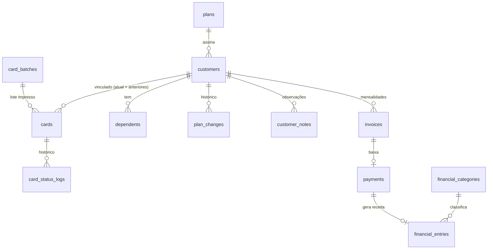

# Sistema de Controle de Cartão Fidelidade — Especificação Técnica

> **Desenvolvimento:** LC Soluções em TI LTDA — CNPJ 41.862.372/0001-04
> **Stack:** Laravel + TALL (Tailwind CSS, Alpine.js, Laravel, Livewire), **sem Filament**
> **Banco de dados:** PostgreSQL

Este documento é o guia de construção do sistema. Ele define stack, modelo de dados, regras de negócio, telas e a ordem de implementação. Pode ser usado como referência pela equipe ou como contexto para um agente de código (ex.: salvar como `docs/SPEC.md` no repositório).

---

## 1. Visão geral

Sistema web para uma clínica médica controlar seu programa de cartão fidelidade:

- **Módulo 1 · Clientes e cartões** — titulares, dependentes, planos, **estoque de cartões pré-impressos** e vínculo do cartão ao cliente, consulta rápida e histórico.
- **Módulo 2 · Faturamento** — mensalidades, baixas de pagamento, inadimplência, suspensão automática e recibo em PDF.
- **Módulo 3 · Financeiro** — receitas, despesas, contas a pagar/receber, fluxo de caixa, painel e relatórios PDF/Excel.

Uma única clínica (não é multi-tenant). Acesso por navegador, responsivo.

---

## 2. Stack e pacotes

| Camada | Escolha |
|---|---|
| Framework | Laravel 12 (ou a versão estável atual) |
| Frontend | Livewire 3, Alpine.js (já incluso no Livewire), Tailwind CSS 4, Vite |
| Starter kit | Starter kit oficial **Livewire** (auth pronta). Componentes de UI próprios em Blade + Tailwind |
| Banco | PostgreSQL |
| Testes | Pest |

| Pacote | Uso |
|---|---|
| `spatie/laravel-permission` | Perfis e permissões (admin, financeiro, atendente) |
| `spatie/laravel-activitylog` | Auditoria (quem alterou o quê) |
| `spatie/laravel-settings` | Configurações da clínica (dias para suspensão, vencimento padrão etc.) |
| `barryvdh/laravel-dompdf` | Recibos e relatórios em PDF |
| `maatwebsite/excel` | Exportação para Excel |
| `lucascudo/laravel-pt-br-localization` (ou equivalente) | Traduções pt-BR de validação e auth |

Configuração base em `.env` / `config/app.php`:

```dotenv
APP_LOCALE=pt_BR
APP_FALLBACK_LOCALE=pt_BR
APP_FAKER_LOCALE=pt_BR
APP_TIMEZONE=America/Sao_Paulo
DB_CONNECTION=pgsql
QUEUE_CONNECTION=database
```

### Instalação

```bash
laravel new cartao-fidelidade   # escolher: Livewire starter kit, Pest, PostgreSQL
cd cartao-fidelidade

composer require spatie/laravel-permission spatie/laravel-activitylog \
  spatie/laravel-settings barryvdh/laravel-dompdf maatwebsite/excel

php artisan vendor:publish --provider="Spatie\Permission\PermissionServiceProvider"
php artisan vendor:publish --provider="Spatie\Activitylog\ActivitylogServiceProvider" --tag="activitylog-migrations"
php artisan vendor:publish --provider="Spatie\LaravelSettings\LaravelSettingsServiceProvider" --tag="migrations"
php artisan migrate
```

> O starter kit Livewire pode trazer o Flux UI. Usar o Flux gratuito é opcional; o padrão deste projeto é ter componentes Blade próprios em `resources/views/components/ui/` para não depender de biblioteca de UI.

---

## 3. Arquitetura e convenções

- **Componentes Livewire de página inteira** para cada tela (`app/Livewire/...`), com rotas apontando direto para o componente.
- **Livewire Form Objects** (`app/Livewire/Forms`) para formulários de cadastro.
- **Actions** (`app/Actions`) para toda regra de negócio que altera dados (ex.: `RegisterPayment`, `SuspendCard`). Componentes Livewire nunca contêm regra de negócio, só chamam Actions.
- Toda Action que grava em mais de uma tabela roda dentro de `DB::transaction()`.
- **Enums PHP** (`app/Enums`) para status, formas de pagamento, parentesco etc., com métodos `label()` e `color()` para a UI.
- **Policies** para autorização em cada model; `authorize()` no `mount()` e nas ações dos componentes.
- **Filtros na URL** com o atributo `#[Url]` do Livewire, para que listas filtradas possam ser compartilhadas e recarregadas.
- Valores monetários em `decimal(12,2)` com cast `decimal:2`. Nunca usar float para dinheiro.
- CPF armazenado **somente com dígitos** (11 caracteres); máscara aplicada só na exibição.
- Datas exibidas no formato `d/m/Y`; valores como `R$ 1.234,56` (helper `money()`).

### Estrutura de pastas

```
app/
├── Actions/
│   ├── Customers/   CreateCustomer, UpdateCustomer, ChangePlan, AddDependent
│   ├── Cards/       RegisterCardBatch, AssignCard, ReplaceCard, DiscardCard,
│   │                SuspendCard, ReactivateCard, CancelCard
│   ├── Billing/     GenerateMonthlyInvoices, RegisterPayment, CancelInvoice
│   └── Finance/     CreateFinancialEntry, SettleFinancialEntry
├── Console/Commands/  GenerateInvoices, MarkOverdueInvoices, SuspendDelinquentCards
├── Enums/
├── Exports/          (classes do maatwebsite/excel)
├── Livewire/
│   ├── Dashboard.php
│   ├── Customers/    Index, Form, Show, QuickSearch
│   ├── Cards/        Stock, BatchForm, ReplaceCardModal
│   ├── Plans/        Index, Form
│   ├── Billing/      Index, Delinquents, PaymentModal
│   ├── Finance/      Entries, Payables, Receivables, CashFlow, Categories
│   └── Reports/      Index
├── Livewire/Forms/   CustomerForm, DependentForm, PlanForm, FinancialEntryForm
├── Models/
├── Policies/
├── Rules/            Cpf.php
├── Services/         CustomerTimeline, DashboardMetrics, CashFlowReport
└── Settings/         ClinicSettings.php
resources/views/
├── components/ui/    button, input, select, modal, table, badge, card, stat
├── livewire/...
└── pdf/              receipt.blade.php, reports/*.blade.php
```

---

## 4. Enums

```php
// app/Enums/CardStatus.php
enum CardStatus: string
{
    // Cartão físico ainda não vinculado
    case InStock = 'in_stock';
    // Cartão vinculado a um cliente
    case Active = 'active';
    case Suspended = 'suspended';
    case Cancelled = 'cancelled';
    // Cartão fora de uso (não volta ao estoque)
    case Lost = 'lost';
    case Discarded = 'discarded';

    public function label(): string
    {
        return match ($this) {
            self::InStock => 'Em estoque',
            self::Active => 'Ativo',
            self::Suspended => 'Suspenso',
            self::Cancelled => 'Cancelado',
            self::Lost => 'Extraviado',
            self::Discarded => 'Inutilizado',
        };
    }

    public function color(): string
    {
        return match ($this) {
            self::InStock => 'sky',
            self::Active => 'green',
            self::Suspended => 'amber',
            self::Cancelled => 'red',
            self::Lost, self::Discarded => 'zinc',
        };
    }

    /** Status em que o cartão está vinculado e "vigente" para o cliente. */
    public static function current(): array
    {
        return [self::Active, self::Suspended];
    }
}
```

| Enum | Casos |
|---|---|
| `CardStatus` | `in_stock` (Em estoque), `active` (Ativo), `suspended` (Suspenso), `cancelled` (Cancelado), `lost` (Extraviado), `discarded` (Inutilizado) |
| `InvoiceStatus` | `open` (Em aberto), `overdue` (Em atraso), `paid` (Pago), `cancelled` (Cancelada) |
| `PaymentMethod` | `cash` (Dinheiro), `pix` (PIX), `card` (Cartão), `boleto` (Boleto) |
| `Kinship` | `spouse` (Cônjuge), `child` (Filho(a)), `father` (Pai), `mother` (Mãe), `sibling` (Irmão(ã)), `other` (Outro) |
| `EntryType` | `income` (Receita), `expense` (Despesa) |
| `EntryStatus` | `pending` (Pendente), `paid` (Pago/Recebido), `cancelled` (Cancelado) |

Cores dos badges: **pago = verde**, **em aberto = azul**, **em atraso = vermelho**, **cancelado = cinza**.

---

## 5. Modelo de dados

### Diagrama



### Tabelas

**plans**
| Coluna | Tipo | Observação |
|---|---|---|
| id | bigint | |
| name | string | Individual, Familiar... |
| description | text null | |
| price | decimal(12,2) | Valor mensal |
| max_dependents | unsignedSmallInteger | 0 = sem dependentes |
| is_active | boolean | Planos inativos não aparecem para novas adesões |
| timestamps / softDeletes | | |

**customers** (titulares)
| Coluna | Tipo | Observação |
|---|---|---|
| id | bigint | |
| plan_id | foreignId | |
| name | string | |
| cpf | char(11) unique | Só dígitos |
| birth_date | date | |
| email | string null | |
| phone | string | Celular/WhatsApp |
| phone_secondary | string null | |
| zip_code, street, number, complement, district, city, state | string | Endereço (state char(2)) |
| due_day | unsignedTinyInteger | Dia de vencimento (1–28) |
| joined_at | date | Data de adesão |
| timestamps / softDeletes | | |

Índices: `cpf` unique; índice em `name` (usar `ILIKE` ou extensão `pg_trgm` para busca parcial).

**card_batches** (lotes de cartões impressos)
| Coluna | Tipo | Observação |
|---|---|---|
| id | bigint | |
| description | string | Ex.: "Lote gráfica out/2026" |
| supplier | string null | Gráfica |
| received_at | date | Data de recebimento |
| quantity | unsignedInteger | Quantidade cadastrada |
| first_number / last_number | string | Faixa (informativo) |
| user_id | foreignId | Quem cadastrou |
| timestamps | | |

**cards** (estoque e cartões vinculados)
| Coluna | Tipo | Observação |
|---|---|---|
| id | bigint | |
| card_batch_id | foreignId null | Lote de origem |
| number | string unique | **Número impresso no cartão**, exatamente como está no plástico |
| customer_id | foreignId null | Nulo enquanto estiver em estoque |
| status | string | `CardStatus` (`in_stock` ao ser cadastrado) |
| assigned_at | date null | Data do vínculo ao cliente |
| status_changed_at | timestamp null | |
| timestamps | | |

Índices: `number` unique; índice (`status`); **índice único parcial** garantindo um só cartão vigente por cliente:

```php
// na migration de cards
DB::statement("CREATE UNIQUE INDEX cards_one_current_per_customer
    ON cards (customer_id) WHERE status IN ('active', 'suspended')");
```

Relacionamentos no model `Customer`:

```php
// cartão vigente (o que está na mão do cliente)
public function card(): HasOne
{
    return $this->hasOne(Card::class)
        ->whereIn('status', CardStatus::current());
}

// todos os cartões que já foram dele (inclui extraviados/substituídos)
public function cards(): HasMany
{
    return $this->hasMany(Card::class);
}
```

**dependents**
| Coluna | Tipo | Observação |
|---|---|---|
| id | bigint | |
| customer_id | foreignId cascadeOnDelete | |
| name | string | |
| cpf | char(11) null | Opcional (crianças); unique quando preenchido |
| birth_date | date | |
| kinship | string | `Kinship` |
| sequence | unsignedTinyInteger | 1, 2, 3... → cartão `000123-01` |
| is_active | boolean | |
| timestamps / softDeletes | | |

**plan_changes**: `customer_id`, `from_plan_id` (null na adesão), `to_plan_id`, `from_price`, `to_price`, `reason` null, `user_id`, `created_at`.

**card_status_logs**: `card_id`, `from_status`, `to_status`, `reason` (ex.: "Suspensão automática: 32 dias em atraso"), `user_id` null (null = sistema), `created_at`.

**customer_notes**: `customer_id`, `user_id`, `body` (text), `timestamps`.

**invoices** (mensalidades)
| Coluna | Tipo | Observação |
|---|---|---|
| id | bigint | |
| customer_id | foreignId | |
| plan_id | foreignId | Plano vigente na geração |
| reference_month | date | Sempre dia 1 (ex.: 2026-10-01) |
| amount | decimal(12,2) | Valor congelado na geração |
| due_date | date | |
| status | string | `InvoiceStatus` |
| paid_at | date null | |
| timestamps | | |

Índices: unique (`customer_id`, `reference_month`); índice (`status`, `due_date`).

**payments**
| Coluna | Tipo | Observação |
|---|---|---|
| id | bigint | |
| invoice_id | foreignId unique | |
| receipt_number | unsignedBigInteger unique | Sequencial do recibo |
| paid_at | date | |
| amount | decimal(12,2) | Pode diferir do valor da fatura (desconto/juros) |
| method | string | `PaymentMethod` |
| notes | text null | |
| user_id | foreignId | Quem registrou |
| timestamps | | |

**financial_categories**: `name`, `type` (`EntryType`), `is_system` (boolean; ex.: "Mensalidades" não pode ser excluída), `is_active`.

**financial_entries** (receitas e despesas; também contas a pagar/receber)
| Coluna | Tipo | Observação |
|---|---|---|
| id | bigint | |
| type | string | `EntryType` |
| financial_category_id | foreignId | |
| description | string | |
| amount | decimal(12,2) | |
| due_date | date | Vencimento |
| status | string | `EntryStatus` |
| paid_at | date null | Data efetiva (base do fluxo de caixa) |
| payment_method | string null | |
| payment_id | foreignId null unique | Preenchido quando gerada por mensalidade |
| supplier_or_payer | string null | Fornecedor / pagador |
| notes | text null | |
| user_id | foreignId | |
| timestamps / softDeletes | | |

Índices: (`type`, `status`, `due_date`), (`paid_at`).

### Configurações (`spatie/laravel-settings`)

```php
// app/Settings/ClinicSettings.php
class ClinicSettings extends Settings
{
    public string $clinic_name;
    public ?string $clinic_cnpj;
    public ?string $clinic_address;
    public ?string $clinic_phone;
    public int $default_due_day;          // ex.: 10
    public int $suspend_after_days;       // ex.: 30 dias de atraso
    public int $invoice_generation_day;   // dia do mês em que as mensalidades do mês seguinte são geradas
    public int $min_card_stock;           // alerta quando o estoque de cartões ficar abaixo disso
    public ?string $card_number_pattern;  // regex opcional do formato impresso, ex.: '^\d{6}$'

    public static function group(): string
    {
        return 'clinic';
    }
}
```

---

## 6. Regras de negócio

### 6.1 Clientes e cartões

1. **CPF**: obrigatório para titular, opcional para dependente; validado pela regra `App\Rules\Cpf`; único entre titulares e entre dependentes.
2. **Estoque de cartões**: os cartões chegam **já impressos** da gráfica e são cadastrados antes de qualquer cliente, por lote (`RegisterCardBatch`), entrando com status `in_stock` e `customer_id` nulo. O sistema **não gera** números de cartão.
   - Cadastro por **faixa** (prefixo opcional + número inicial + número final + quantidade de dígitos, ex.: `000001` a `000500`) ou por **lista/CSV** quando a numeração não for sequencial.
   - Números duplicados ou fora do `card_number_pattern` são rejeitados, e a tela mostra quais foram ignorados.
3. **Vínculo do cartão ao cliente** (`AssignCard`): no cadastro do titular, o atendente informa o número do cartão que está entregando (digitado ou lido por leitor de código de barras/QR, que funciona como teclado). Só é aceito cartão com status `in_stock`. Ao vincular: `customer_id` preenchido, status `active`, `assigned_at` = hoje, log em `card_status_logs`. O cadastro do titular e o vínculo acontecem na mesma transação; não existe titular sem cartão.
4. **Segunda via** (`ReplaceCard`): em caso de perda, roubo ou dano, o cartão atual vai para `lost` ou `discarded` e um novo cartão do estoque é vinculado, **herdando o status** do anterior (se estava suspenso, continua suspenso). O cartão antigo continua no histórico do cliente e não pode ser reutilizado.
5. **Cartão danificado no estoque** (`DiscardCard`): pode ser marcado como `discarded` direto no estoque, com motivo.
6. **Dependentes**: usam o mesmo cartão físico do titular e recebem identificação `{numero_cartao}-{sequence:02}` (ex.: `000123-02`). O `sequence` nunca é reaproveitado. Na segunda via, a identificação passa a usar o novo número automaticamente (é calculada, não armazenada).
7. **Limite de dependentes**: ao adicionar dependente, validar `dependentes ativos < plano.max_dependents`. Mensagem clara quando o limite for atingido.
8. **Troca de plano** (`ChangePlan`): valida se os dependentes ativos cabem no novo plano; grava `plan_changes`; o novo valor vale a partir da **próxima** mensalidade gerada (faturas já geradas não mudam).
9. **Status do cartão**: o dependente herda o status do cartão do titular. Cartão cancelado não gera mensalidades, não é reativado automaticamente e **não volta ao estoque**.
10. Toda mudança de status (inclusive entrada em estoque, vínculo e segunda via) grava `card_status_logs`.
11. **Busca por número antigo**: a consulta rápida encontra o cliente também por números de cartões anteriores, avisando que aquele cartão foi substituído.

### 6.2 Faturamento

1. **Geração** (`GenerateMonthlyInvoices`): para cada titular com cartão `active` ou `suspended`, cria a fatura do mês de referência se ainda não existir (a unique key garante idempotência). `amount` = preço atual do plano; `due_date` = `reference_month` com o dia `customer.due_day`.
2. **Primeira mensalidade**: gerada na adesão, com vencimento no próximo `due_day`.
3. **Em atraso**: comando diário muda `open` → `overdue` quando `due_date < hoje`.
4. **Dias em atraso** = `hoje - due_date` (calculado, não armazenado).
5. **Registro de pagamento** (`RegisterPayment`, em transação):
   - cria `payments` com próximo `receipt_number`;
   - marca a fatura como `paid` e preenche `paid_at`;
   - cria `financial_entries` do tipo receita, categoria "Mensalidades", status `paid`, vinculada ao pagamento;
   - se o cartão estiver `suspended` e não restar nenhuma fatura com mais de `suspend_after_days` dias de atraso, reativa o cartão (`ReactivateCard`, motivo "Reativação por pagamento").
6. **Suspensão automática**: comando diário suspende cartões `active` que tenham fatura `overdue` com atraso **maior ou igual** a `suspend_after_days`.
7. **Estorno**: cancelar um pagamento (só perfil admin) volta a fatura para `open`/`overdue` e cancela a receita vinculada. Não apagar registros.
8. **Recibo**: PDF gerado sob demanda a partir do `payment` (não armazenar arquivo), com dados da clínica, titular, cartão, referência, valor, forma e data.

```php
// app/Actions/Billing/RegisterPayment.php
class RegisterPayment
{
    public function __construct(
        private ReactivateCard $reactivateCard,
        private ClinicSettings $settings,
    ) {}

    public function handle(Invoice $invoice, array $data, User $user): Payment
    {
        return DB::transaction(function () use ($invoice, $data, $user) {
            $invoice = Invoice::lockForUpdate()->findOrFail($invoice->id);

            if ($invoice->status === InvoiceStatus::Paid) {
                throw ValidationException::withMessages(['invoice' => 'Esta mensalidade já foi paga.']);
            }

            $payment = $invoice->payment()->create([
                'receipt_number' => (Payment::max('receipt_number') ?? 0) + 1,
                'paid_at' => $data['paid_at'],
                'amount' => $data['amount'],
                'method' => $data['method'],
                'notes' => $data['notes'] ?? null,
                'user_id' => $user->id,
            ]);

            $invoice->update(['status' => InvoiceStatus::Paid, 'paid_at' => $data['paid_at']]);

            FinancialEntry::create([
                'type' => EntryType::Income,
                'financial_category_id' => FinancialCategory::monthlyFees()->id,
                'description' => "Mensalidade {$invoice->reference_month->format('m/Y')} - {$invoice->customer->name}",
                'amount' => $payment->amount,
                'due_date' => $invoice->due_date,
                'paid_at' => $payment->paid_at,
                'status' => EntryStatus::Paid,
                'payment_method' => $payment->method,
                'payment_id' => $payment->id,
                'user_id' => $user->id,
            ]);

            $card = $invoice->customer->card;
            $stillDelinquent = $invoice->customer->invoices()
                ->where('status', InvoiceStatus::Overdue)
                ->where('due_date', '<=', now()->subDays($this->settings->suspend_after_days))
                ->exists();

            if ($card->status === CardStatus::Suspended && ! $stillDelinquent) {
                $this->reactivateCard->handle($card, 'Reativação por pagamento');
            }

            return $payment;
        });
    }
}
```

> Para o `receipt_number`, preferir uma sequence do PostgreSQL (`receipt_number_seq`) em vez de `max() + 1` caso haja vários usuários registrando pagamentos ao mesmo tempo.

### 6.3 Financeiro

1. **Receitas de mensalidades** entram automaticamente pela `RegisterPayment` e **não podem ser editadas** manualmente (só via estorno do pagamento).
2. **Lançamentos manuais**: receitas e despesas avulsas com categoria, valor, vencimento e, opcionalmente, já baixadas.
3. **Contas a pagar** = despesas `pending`. **Contas a receber** = receitas manuais `pending` + mensalidades `open`/`overdue` (estas somente leitura, com link para o faturamento).
4. **Baixa** de conta: informa `paid_at` e forma de pagamento → status `paid`.
5. **Fluxo de caixa** (regime de caixa, baseado em `paid_at`):
   - saldo inicial = receitas pagas − despesas pagas antes do início do período;
   - visão **diária** (dias do mês) e **mensal** (meses do ano), com entradas, saídas, saldo do dia/mês e saldo acumulado;
   - linha opcional de **previsto** usando `due_date` dos itens pendentes.

### 6.4 Indicadores do painel

| Indicador | Cálculo |
|---|---|
| Cartões ativos | `cards.status = active` |
| Cartões em estoque | `cards.status = in_stock` (alerta quando `< min_card_stock`) |
| Vidas atendidas | titulares ativos + dependentes ativos de cartões ativos |
| Receita do mês | soma de `financial_entries` receita, `paid`, `paid_at` no mês atual |
| Despesa do mês | idem, despesa |
| Valor em aberto | soma de `invoices` com status `open` + `overdue` |
| Valor em atraso | soma de `invoices` com status `overdue` |
| Índice de inadimplência | titulares com ao menos uma fatura `overdue` ÷ titulares com cartão ativo ou suspenso (%) |

Mais um gráfico de receita x despesa dos últimos 12 meses (Chart.js ou ApexCharts via Alpine) e a lista dos 5 maiores atrasos.

---

## 7. Regra de validação de CPF

```php
// app/Rules/Cpf.php
namespace App\Rules;

use Closure;
use Illuminate\Contracts\Validation\ValidationRule;

class Cpf implements ValidationRule
{
    public function validate(string $attribute, mixed $value, Closure $fail): void
    {
        $cpf = preg_replace('/\D/', '', (string) $value);

        if (strlen($cpf) !== 11 || preg_match('/^(\d)\1{10}$/', $cpf)) {
            $fail('O CPF informado é inválido.');
            return;
        }

        for ($t = 9; $t < 11; $t++) {
            $sum = 0;
            for ($i = 0; $i < $t; $i++) {
                $sum += (int) $cpf[$i] * (($t + 1) - $i);
            }
            $digit = ((10 * $sum) % 11) % 10;

            if ((int) $cpf[$t] !== $digit) {
                $fail('O CPF informado é inválido.');
                return;
            }
        }
    }
}
```

No Form Object, normalizar antes de validar/salvar: `$this->cpf = preg_replace('/\D/', '', $this->cpf);`. Máscara no input com Alpine (`x-mask="999.999.999-99"` do plugin `@alpinejs/mask`, que já vem no Livewire 3).

---

## 8. Telas

### Layout
- Sidebar com: Painel, Consulta rápida, Clientes, Planos, Estoque de cartões, Faturamento, Inadimplentes, Financeiro (Lançamentos, Contas a pagar, Contas a receber, Fluxo de caixa, Categorias), Relatórios, Configurações, Usuários.
- Itens exibidos conforme permissão. Menu recolhível no mobile (Alpine).
- Notificações "toast" via evento Livewire `dispatch('notify', message: ..., type: ...)` escutado por um componente Alpine global.

### Rotas

```php
// routes/web.php
Route::middleware(['auth'])->group(function () {
    // Página inicial: atendente vai direto para a consulta; demais perfis para o painel
    Route::get('/', HomeController::class)->name('home');
    Route::get('/painel', Dashboard::class)->middleware('can:dashboard.view')->name('dashboard');

    // --- Atendimento (atendente, financeiro, admin) ---
    Route::get('/consulta', Customers\QuickSearch::class)->middleware('can:cards.check')->name('quick-search');
    Route::get('/vendas/nova', Customers\Form::class)->middleware('can:sales.create')->name('sales.create');

    // --- Gestão de clientes ---
    Route::middleware('can:customers.view')->group(function () {
        Route::get('/clientes', Customers\Index::class)->name('customers.index');
        Route::get('/clientes/{customer}', Customers\Show::class)->name('customers.show');
    });
    Route::get('/clientes/{customer}/editar', Customers\Form::class)->middleware('can:customers.update')->name('customers.edit');

    Route::get('/planos', Plans\Index::class)->middleware('can:plans.manage')->name('plans.index');
    Route::get('/cartoes', Cards\Stock::class)->middleware('can:cards.stock.view')->name('cards.stock');

    // --- Faturamento ---
    Route::middleware('can:billing.view')->group(function () {
        Route::get('/faturamento', Billing\Index::class)->name('billing.index');
        Route::get('/faturamento/inadimplentes', Billing\Delinquents::class)->name('billing.delinquents');
        Route::get('/recibos/{payment}', ReceiptController::class)->name('receipts.show');
    });

    // --- Financeiro ---
    Route::prefix('financeiro')->name('finance.')->middleware('can:finance.view')->group(function () {
        Route::get('/lancamentos', Finance\Entries::class)->name('entries');
        Route::get('/contas-a-pagar', Finance\Payables::class)->name('payables');
        Route::get('/contas-a-receber', Finance\Receivables::class)->name('receivables');
        Route::get('/fluxo-de-caixa', Finance\CashFlow::class)->name('cash-flow');
        Route::get('/categorias', Finance\Categories::class)->name('categories');
    });

    Route::get('/relatorios', Reports\Index::class)->middleware('can:reports.view')->name('reports.index');
    Route::get('/configuracoes', Settings\Clinic::class)->middleware('can:settings.manage')->name('settings');
    Route::get('/usuarios', Users\Index::class)->middleware('can:users.manage')->name('users.index');
});
```

### Módulo 1
| Tela | Conteúdo |
|---|---|
| **Consulta rápida** | Campo único com foco automático; busca por nome, CPF ou número do cartão (inclusive `000123-02` de dependente) com `wire:model.live.debounce.300ms`. Resultado em card grande: nome, plano, **badge de status do cartão** bem visível e dependentes. Próxima mensalidade, pendências e valores aparecem **somente** para quem tem `billing.view`; para o atendente, cartão suspenso mostra apenas "Cartão suspenso — encaminhar ao financeiro". |
| **Nova venda** | Mesmo formulário do cadastro de titular (cartão do estoque + dados + dependentes + plano), acessível ao atendente. Ao concluir, volta para a consulta rápida já exibindo o cliente recém-cadastrado. |
| **Clientes (lista)** | Tabela paginada: cartão, nome, CPF mascarado, plano, nº de dependentes, status. Filtros: status, plano, busca. Botão "Novo cliente". |
| **Cadastro/edição** | Seções: **Cartão** (campo do número com validação em tempo real: mostra "Disponível", "Já vinculado a Fulano", "Extraviado" ou "Não cadastrado no estoque"; aceita leitor de código de barras), Dados pessoais, Contato, Endereço (autopreenchimento por CEP via ViaCEP com `fetch` no Alpine), Plano e vencimento. Na criação, permite já adicionar dependentes na mesma tela (repeater Livewire) respeitando o limite do plano. |
| **Ficha do cliente** | Abas (Alpine): **Resumo** (dados + cartão vigente + ações: trocar plano, **segunda via do cartão**, suspender, reativar, cancelar; lista dos cartões anteriores), **Dependentes** (lista + modal de inclusão/edição), **Mensalidades** (faturas do cliente com ação de baixa), **Histórico** (timeline) e **Observações** (adicionar nota). |
| **Planos** | CRUD em modal: nome, valor, limite de dependentes, ativo. |
| **Estoque de cartões** | Cards no topo: em estoque, vinculados, extraviados/inutilizados (alerta visual abaixo do mínimo). Tabela com número, lote, status, cliente vinculado e data. Filtros por status, lote e número. Ações: **Cadastrar lote** (faixa ou lista/CSV, com prévia antes de confirmar), **Inutilizar cartão**. Aba de lotes com quantidade usada/disponível por lote. |

**Timeline** (`App\Services\CustomerTimeline`): junta em ordem cronológica adesão, `plan_changes`, `card_status_logs`, pagamentos e observações, retornando uma coleção de DTOs `{date, type, title, description, user}`.

### Módulo 2
| Tela | Conteúdo |
|---|---|
| **Faturamento** | Cards de resumo no topo (total do período, pago, em aberto, em atraso). Tabela: cliente, cartão, referência, vencimento, valor, **badge de status**, dias em atraso. Filtros: período (mês de referência ou intervalo de vencimento), status, plano, cliente. Ação "Registrar pagamento" abre `PaymentModal` (data, valor pré-preenchido, forma, observação). Após a baixa: toast + botão "Imprimir recibo". |
| **Inadimplentes** | Titulares com faturas em atraso: nome, telefone (link `https://wa.me/55...`), qtd. de faturas, valor total, maior atraso em dias, status do cartão. Ordenado pelo maior atraso. Exporta PDF/Excel. |
| **Recibo** | `ReceiptController` retorna `Pdf::loadView('pdf.receipt', ...)->stream("recibo-{$n}.pdf")`. |

### Módulo 3
| Tela | Conteúdo |
|---|---|
| **Lançamentos** | Lista de receitas e despesas com filtros (tipo, categoria, status, período). Modal de criação/edição. Lançamentos automáticos exibem ícone de cadeado. |
| **Contas a pagar** | Despesas pendentes agrupadas por vencidas / vencendo em 7 dias / futuras. Ação de baixa. |
| **Contas a receber** | Receitas pendentes + mensalidades em aberto/atraso (somente leitura, com link). |
| **Fluxo de caixa** | Alternância Diário / Mensal; seletor de mês ou ano; tabela com entradas, saídas, saldo e saldo acumulado; gráfico de barras. |
| **Categorias** | CRUD simples; categorias de sistema bloqueadas para exclusão. |
| **Painel** | Indicadores da seção 6.4 em cards + gráfico + últimos pagamentos + maiores atrasos. |
| **Relatórios** | Seleção do relatório e período; botões "PDF" e "Excel". |

### Relatórios disponíveis
1. Clientes e dependentes (por plano/status)
2. Mensalidades por período e status
3. Inadimplência
4. Pagamentos recebidos (por forma de pagamento)
5. Lançamentos financeiros (por categoria)
6. Fluxo de caixa

Cada relatório tem uma classe de consulta reaproveitada por dois lugares: `App\Exports\*Export` (Excel, implementando `FromQuery`, `WithHeadings`, `WithMapping`, `WithColumnFormatting`) e uma view em `resources/views/pdf/reports/`. Relatórios grandes em Excel podem usar `ShouldQueue` e notificar quando prontos.

---

## 9. Agendamentos

```php
// routes/console.php
Schedule::command('invoices:mark-overdue')->dailyAt('00:10');
Schedule::command('cards:suspend-delinquent')->dailyAt('00:20');
Schedule::command('invoices:generate')->dailyAt('01:00'); // gera só no dia configurado; idempotente
```

- `invoices:generate {--month=}` — gera as mensalidades do mês seguinte quando `today()->day == invoice_generation_day`, ou do mês informado manualmente.
- `invoices:mark-overdue` — `open` com `due_date < hoje` → `overdue`.
- `cards:suspend-delinquent` — aplica a regra 6.2.6 e registra log com o motivo.

Todos os comandos registram no activity log a quantidade de registros afetados.

---

## 10. Perfis e permissões

Implementado com `spatie/laravel-permission`. São três perfis:

- **Admin** — acesso total.
- **Financeiro** — gestão de clientes, faturamento, financeiro e relatórios.
- **Atendente** — **apenas realiza vendas e consulta o status do cartão**. Não acessa faturamento, financeiro, relatórios, painel com indicadores nem configurações, e não vê valores de mensalidades ou pendências.

### 10.1 Permissões

| Permissão | Descrição | Admin | Financeiro | Atendente |
|---|---|:-:|:-:|:-:|
| `cards.check` | Consulta rápida do status do cartão | ✔ | ✔ | ✔ |
| `sales.create` | Nova venda: cadastrar titular, dependentes e vincular cartão do estoque | ✔ | ✔ | ✔ |
| `dashboard.view` | Painel com indicadores | ✔ | ✔ | |
| `customers.view` | Lista e ficha completa do cliente | ✔ | ✔ | |
| `customers.update` | Editar cliente e dependentes após a venda | ✔ | ✔ | |
| `cards.manage` | Trocar plano, segunda via, suspender, reativar, cancelar | ✔ | ✔ | |
| `cards.stock.view` | Ver estoque de cartões | ✔ | ✔ | |
| `cards.stock.manage` | Cadastrar lote, inutilizar cartão | ✔ | ✔ | |
| `plans.manage` | Gerenciar planos | ✔ | | |
| `billing.view` | Ver faturamento, inadimplentes e recibos | ✔ | ✔ | |
| `billing.pay` | Registrar pagamento | ✔ | ✔ | |
| `billing.refund` | Estornar pagamento | ✔ | | |
| `finance.view` | Ver lançamentos, contas e fluxo de caixa | ✔ | ✔ | |
| `finance.manage` | Criar, editar e baixar lançamentos | ✔ | ✔ | |
| `reports.view` | Relatórios e exportações | ✔ | ✔ | |
| `settings.manage` | Configurações da clínica | ✔ | | |
| `users.manage` | Usuários e perfis | ✔ | | |

### 10.2 Seeder

```php
// database/seeders/RolesAndPermissionsSeeder.php
class RolesAndPermissionsSeeder extends Seeder
{
    public function run(): void
    {
        app()[PermissionRegistrar::class]->forgetCachedPermissions();

        $permissions = [
            'cards.check', 'sales.create', 'dashboard.view',
            'customers.view', 'customers.update', 'cards.manage',
            'cards.stock.view', 'cards.stock.manage', 'plans.manage',
            'billing.view', 'billing.pay', 'billing.refund',
            'finance.view', 'finance.manage', 'reports.view',
            'settings.manage', 'users.manage',
        ];

        foreach ($permissions as $permission) {
            Permission::findOrCreate($permission);
        }

        Role::findOrCreate('admin'); // recebe tudo via Gate::before

        Role::findOrCreate('financeiro')->syncPermissions([
            'cards.check', 'sales.create', 'dashboard.view',
            'customers.view', 'customers.update', 'cards.manage',
            'cards.stock.view', 'cards.stock.manage',
            'billing.view', 'billing.pay',
            'finance.view', 'finance.manage', 'reports.view',
        ]);

        Role::findOrCreate('atendente')->syncPermissions([
            'cards.check', 'sales.create',
        ]);
    }
}
```

```php
// app/Providers/AppServiceProvider.php → boot()
Gate::before(fn (User $user) => $user->hasRole('admin') ? true : null);
```

### 10.3 Onde a permissão é verificada

A verificação acontece em **quatro camadas**. Esconder o menu não basta, porque componentes Livewire podem ser chamados diretamente.

1. **Rotas** — middleware `can:` em todas as rotas (seção 8). Acesso negado retorna 403 com página amigável (`resources/views/errors/403.blade.php`).
2. **Componentes Livewire** — `authorize()` no `mount()` **e** em cada método público que altera dados:

```php
class PaymentModal extends Component
{
    public function mount(Invoice $invoice): void
    {
        $this->authorize('billing.pay');
        // ...
    }

    public function save(RegisterPayment $action): void
    {
        $this->authorize('billing.pay'); // de novo: métodos Livewire podem ser chamados direto
        // ...
    }
}
```

3. **Policies** — `CustomerPolicy`, `CardPolicy`, `InvoicePolicy`, `PaymentPolicy`, `FinancialEntryPolicy` mapeando cada ação para a permissão correspondente.
4. **Views** — `@can` / `@cannot` no menu, nos botões e nos blocos de informação financeira:

```blade
{{-- resources/views/livewire/customers/quick-search.blade.php --}}
<x-ui.badge :color="$card->status->color()">{{ $card->status->label() }}</x-ui.badge>

@can('billing.view')
    <x-customers.pending-invoices :customer="$customer" />
@else
    @if ($card->status === \App\Enums\CardStatus::Suspended)
        <p class="text-amber-700">Cartão suspenso — encaminhar ao financeiro.</p>
    @endif
@endcan
```

### 10.4 Regras específicas do atendente

- **Página inicial**: `HomeController` redireciona o atendente para `/consulta` e os demais perfis para `/painel`.
- **Menu**: o atendente vê somente **Consulta rápida** e **Nova venda**.
- **Venda**: ao concluir, a primeira mensalidade é gerada normalmente pelo sistema, mas o atendente não a visualiza.
- **Sem edição posterior**: correções de cadastro depois da venda ficam com o financeiro (`customers.update`).
- **Validação do cartão na venda**: mostra "Disponível", "Já vinculado", "Extraviado/Inutilizado" ou "Não cadastrado", sem expor o nome de outro cliente para o atendente.
- **Busca**: na consulta rápida, o CPF aparece mascarado para o atendente.

### 10.5 Gestão de usuários

Tela `Users\Index` (somente admin): criar usuário, definir perfil, ativar/desativar (campo `is_active` em `users`; usuário inativo é bloqueado no login) e redefinir senha.

---

## 11. Segurança e LGPD

- Auditoria com `spatie/laravel-activitylog` nos models `Customer`, `Dependent`, `Card`, `Plan`, `Invoice`, `Payment`, `FinancialEntry` (`LogsActivity`, registrando apenas campos alterados).
- Soft delete em cadastros; não excluir fisicamente pagamentos nem lançamentos.
- CPF mascarado nas listagens (`***.456.789-**`), completo apenas na ficha.
- Exportação dos dados de um titular (direito de acesso) na ficha do cliente.
- HTTPS obrigatório, sessões com `SESSION_SECURE_COOKIE=true`, rate limit no login.
- Backup diário do PostgreSQL (`pg_dump` via cron ou `spatie/laravel-backup`) com retenção de 30 dias, fora do servidor.

---

## 12. Testes (Pest)

Cobertura mínima com testes de feature/unitários para:

- [ ] Regra `Cpf` (válidos, inválidos, sequências repetidas, com máscara)
- [ ] Cadastro de lote por faixa e por lista, rejeitando duplicados
- [ ] Criar titular vincula cartão do estoque (ativo) e gera a primeira mensalidade
- [ ] Não permite vincular cartão já vinculado, extraviado, inutilizado ou inexistente
- [ ] Índice parcial impede dois cartões vigentes para o mesmo cliente
- [ ] Segunda via: antigo vai para extraviado, novo herda status, busca por número antigo funciona
- [ ] Limite de dependentes por plano (inclusão e troca de plano)
- [ ] Identificação do dependente (`000123-02`) e busca por ela
- [ ] `invoices:generate` é idempotente e usa o preço vigente do plano
- [ ] `invoices:mark-overdue` só altera faturas vencidas
- [ ] `cards:suspend-delinquent` respeita `suspend_after_days`
- [ ] `RegisterPayment` cria pagamento, receita e reativa o cartão; impede pagamento duplicado
- [ ] Estorno reverte fatura e lançamento
- [ ] Fluxo de caixa: saldo inicial e acumulado corretos
- [ ] Indicadores do painel
- [ ] Permissões do atendente: acessa `/consulta` e `/vendas/nova`; recebe 403 em `/painel`, `/clientes`, `/cartoes`, `/faturamento`, `/financeiro/*`, `/relatorios`, `/configuracoes`
- [ ] Atendente não consegue chamar métodos protegidos via Livewire (`Livewire::test(PaymentModal::class)->call('save')` → 403)
- [ ] Consulta rápida do atendente não exibe valores nem mensalidades
- [ ] Atendente é redirecionado para a consulta rápida após o login
- [ ] Usuário inativo não consegue entrar

---

## 13. Seeders

- `RolesAndPermissionsSeeder` + usuário admin inicial
- `PlanSeeder` (Individual, Familiar)
- `DemoSeeder` cria também um lote de cartões em estoque (apenas local)
- `FinancialCategorySeeder` (Mensalidades [sistema], Outras receitas, Aluguel, Salários, Materiais, Marketing, Impostos, Outras despesas)
- `ClinicSettings` com valores padrão (vencimento dia 10, suspensão com 30 dias)
- `DemoSeeder` (apenas local) com factories: 50 titulares, dependentes, 6 meses de mensalidades com pagamentos e atrasos variados

---

## 14. Plano de implementação

**Etapa 1 · Base (semana 1)**
- [ ] Projeto, starter kit Livewire, pt-BR, timezone, PostgreSQL
- [ ] Pacotes, perfis e permissões (seeder, `Gate::before`, middleware nas rotas, redirecionamento do atendente), layout com sidebar filtrada por `@can`, componentes `ui/*`
- [ ] Tela de usuários (admin)
- [ ] Settings da clínica e tela de configurações
- [ ] Enums e helpers (`money()`, máscara de CPF)

**Etapa 2 · Clientes e cartões (semanas 2–3)**
- [ ] Migrations e models: plans, card_batches, cards, customers, dependents, plan_changes, card_status_logs, customer_notes
- [ ] CRUD de planos
- [ ] Estoque de cartões: cadastro de lote, listagem, inutilização
- [ ] Cadastro de titular com vínculo do cartão do estoque, dependentes, CEP e validação de CPF
- [ ] Segunda via do cartão
- [ ] Ficha do cliente com abas, troca de plano e mudanças de status
- [ ] Consulta rápida
- [ ] Timeline do cliente

**Etapa 3 · Faturamento (semanas 4–5)**
- [ ] Migrations: invoices, payments
- [ ] Geração de mensalidades (adesão + comando mensal)
- [ ] Tela de faturamento com filtros e resumo
- [ ] Modal de pagamento e Action `RegisterPayment`
- [ ] Comandos de atraso e suspensão + agendamento
- [ ] Tela de inadimplentes
- [ ] Recibo em PDF e estorno

**Etapa 4 · Financeiro (semana 6)**
- [ ] Migrations: financial_categories, financial_entries
- [ ] Lançamentos, contas a pagar e a receber, baixas
- [ ] Fluxo de caixa diário e mensal
- [ ] Painel com indicadores e gráfico
- [ ] Relatórios PDF e Excel

**Etapa 5 · Implantação (semana 7)**
- [ ] Testes finais e revisão de permissões
- [ ] Deploy (ver seção 15)
- [ ] Carga inicial de planos, categorias, usuários e **lotes de cartões já impressos**
- [ ] Treinamento da equipe

---

## 15. Deploy (Ubuntu Server)

- Nginx + PHP-FPM (versão exigida pelo Laravel instalado) + PostgreSQL
- `composer install --no-dev --optimize-autoloader` e `npm ci && npm run build`
- `php artisan migrate --force`, `php artisan optimize`
- Cron: `* * * * * cd /var/www/cartao-fidelidade && php artisan schedule:run >> /dev/null 2>&1`
- Supervisor para `php artisan queue:work --tries=3` (exports de Excel e jobs)
- Certificado SSL com Certbot
- Backup diário do banco para armazenamento externo
